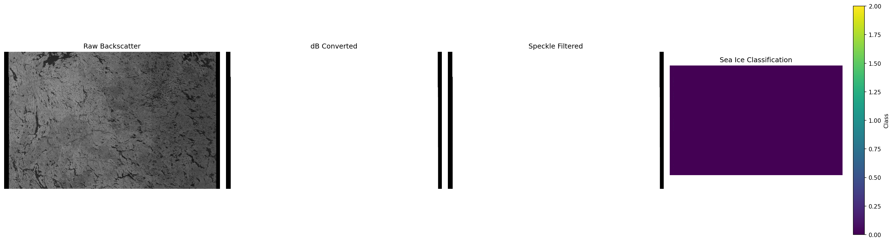

# ❄️ CryoSAR

**SAR-based analysis of Arctic sea ice using Sentinel-1 imagery.**


## Features

- Load Sentinel-1 GRD products (.tif)
- Convert backscatter to dB scale
- Apply speckle filtering (3x3 mean)
- Classify sea ice types:
  - Open Water (-30 to -20 dB)
  - New Ice (-20 to -12 dB)
  - First-Year Ice (-12 to -6 dB)
  - Multi-Year Ice (-6 to 0 dB)
- Visualize results
- Interactive Streamlit dashboard

## Installation

```bash
git clone https://github.com/imabbas8/cryo-sar.git
cd cryo-sar
pip install -r requirements.txt
```

## Output



_Four-panel visualization of Sentinel-1 SAR imagery over the Canadian Arctic:
(a) raw backscatter, (b) dB-converted, (c) speckle-filtered, and
(d) sea ice classification._
